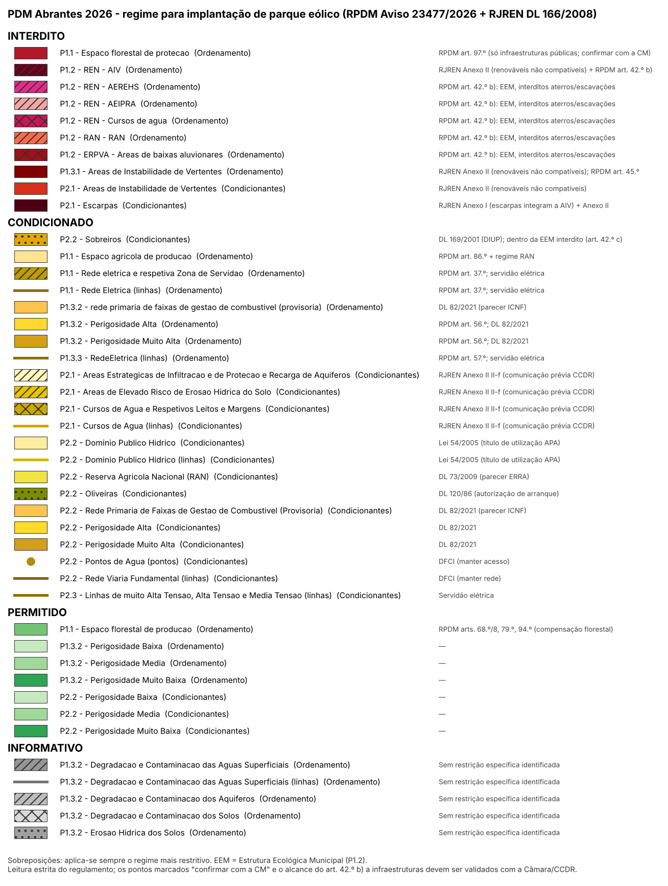

# PDM-Abrantes

Plano Diretor Municipal de Abrantes (PDM 2026) em shapefiles editáveis, com cada subcategoria classificada como **interdita, condicionada ou permitida** para a implantação de um parque eólico (Regulamento do PDM + RJREN). Área atual: zona do parque Amarvento (4 prédios + 200 m).

Fonte: MuniSIG de Abrantes, serviço `PMOTs/PDM_2026/MapServer` (polígonos originais da Câmara, não vectorização de imagens). Coordenadas: **EPSG:3763 (PT-TM06/ETRS89)**.

## Como repetir para outro terreno de Abrantes

Guia completo, com os erros mais comuns: **[4_Como_Repetir/](4_Como_Repetir/)**. Resumo:

1. Abre o visualizador MuniSIG de Abrantes no Chrome, liga uma camada do PDM e abre o DevTools (F12) > **Network**. Filtra por `export` e copia o `token` do separador **Payload**.
2. Em `4_Como_Repetir/scripts/1_extrair_PDM.js` muda as duas linhas do topo: `TOKEN` e `AREA` (xmin, ymin, xmax, ymax em EPSG:3763). Cola o script na **Console** e carrega Enter. Descarrega `PDM_Abrantes.json`.
3. Faz o mesmo com `2_extrair_PIF.js` (perigosidade de incêndio, pedida por blocos). Descarrega `PIF_Abrantes.json`.
4. No computador, com Python e `geopandas` instalados, na pasta `4_Como_Repetir/scripts`:
   ```
   python 3_json_para_shapefiles.py PDM_Abrantes.json PIF_Abrantes.json saida/camadas_originais
   python 4_separar_por_subcategoria.py PDM_Abrantes.json saida/camadas_originais saida/1_Shapefiles
   python 5_generalizar_PIF.py saida/camadas_originais saida/1_Shapefiles
   python 6_aplicar_cores.py saida/1_Shapefiles
   python 7_gerar_kmz_google_earth.py saida/1_Shapefiles saida/PDM_regime.kmz
   python 8_gerar_legenda.py saida/Legenda_regime.png
   ```
5. Se o passo 6 disser `em falta [...]`, o terreno novo tem subcategorias que ainda não estão classificadas: acrescenta-as em `scripts/regimes.py` (regime, artigo, cor) e corre de novo os passos 6 a 8.

## O que está no repositório

| Pasta | Para quê |
|---|---|
| **`1_Shapefiles/`** | **O resultado principal.** Um shapefile por subcategoria, em `Ordenamento/` e `Condicionantes/`, já com cores (`.qml`, o QGIS aplica sozinho) e campos `REGIME` e `BASE` (artigo). |
| `2_Google_Earth/` | O mesmo num KMZ com cores, organizado por regime (o Google Earth ignora os `.qml`). |
| `3_Legenda_e_Regras/` | Legenda, matriz de regime com os artigos, linha das renováveis da tabela do RJREN e o Regulamento do PDM. |
| `4_Como_Repetir/` | Guia passo a passo e scripts. |
| `_tecnico/` | Para validar ou refazer: camadas tal como vieram do servidor, JSON originais, PIF generalizada e agregados para o `gerar_implantacao.py`. |

## Cores



- **Vermelhos = interdito.** **Amarelos = condicionado** (ultrapassável com título, parecer, DIUP ou comunicação prévia). Verdes = permitido. Cinzentos = informativo.
- Onde as camadas se sobrepõem, vale a mais restritiva.
- Sobreiros: condicionado (DIUP, DL 169/2001), mas interdito dentro da Estrutura Ecológica Municipal (RPDM art. 42.º c).
- Espaço Florestal de Proteção (art. 97.º) e o alcance do art. 42.º b) a infraestruturas são leituras estritas, a confirmar com a Câmara/CCDR.

## Limitações
- Só o PDM. Rede Natura, servidões aeronáuticas e outras restrições fora do PDM não estão incluídas.
- Os polígonos são inteiros (não recortados pela área pedida).
- A perigosidade de incêndio em `1_Shapefiles/` está generalizada (manchas < 500 m² absorvidas pela vizinha) para se ler bem no mapa. Para medir áreas usa a original exata, `_tecnico/camadas_originais/145_PIF_Abrantes_2025.shp`.
